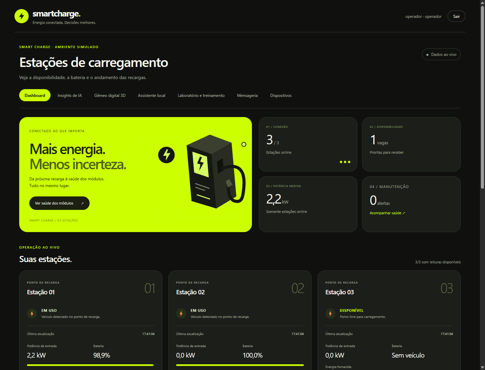
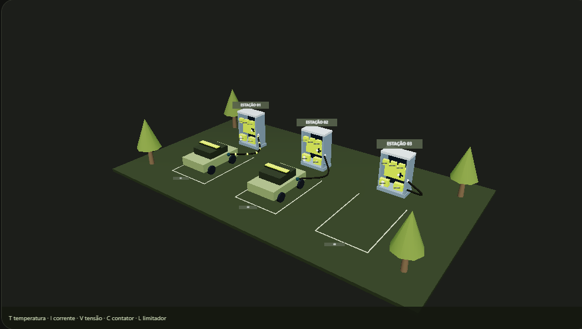
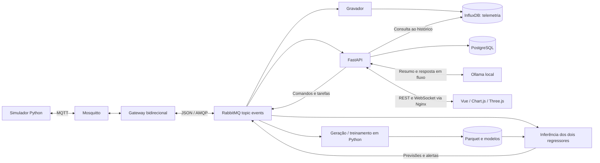

# Smart Charge — recarga e manutenção preditiva

Projeto acadêmico AIoT que evolui o monitoramento de vagas do primeiro bimestre para uma aplicação Web + IoT + IA. Mantém **três pontos de recarga** e acompanha o desgaste dos seus módulos de potência, com sensores de temperatura, corrente e tensão, controle de recarga e previsões de saúde e vida útil restante.

Os equipamentos e as falhas são **simulados em Python**. Não é necessário ter ESP32, carregador físico, GPU, Python ou Node.js instalados na máquina de avaliação. O backend é FastAPI; Node.js é usado somente para compilar o frontend Vue/TypeScript.



A interface usa superfícies grafite, destaques em verde-lima e detalhes expansíveis. O resumo reúne conexão, disponibilidade, potência medida nas estações online e alertas registrados; indicadores indisponíveis não são substituídos por números de demonstração. A ilustração do carregador é decorativa; a cena Three.js e seus estados continuam recebendo dados ao vivo.

## Comece aqui

Pré-requisitos: Git, Docker com Docker Compose e internet na primeira execução. No Windows, use Docker Desktop com WSL2 e containers Linux. Reserve **pelo menos 8 GB para Docker/WSL2**; a máquina de desenvolvimento tem 16 GB de RAM. O primeiro uso baixa imagens e o modelo local de linguagem e pode levar vários minutos. Geração e treinamento são limitados para evitar uso excessivo de memória.

```bash
git clone --branch desenvolvimento-bimestre2 https://github.com/LuizaZants/smart-charge.git
cd smart-charge
docker compose up -d --build
```

Acesse **http://localhost:8080**. A documentação interativa da API está em **http://localhost:8080/docs**. Verifique a inicialização com:

```bash
docker compose ps -a
```

Os serviços contínuos devem ficar `healthy`. As tarefas `bootstrap`, `mqtt-init`, `db-init` e `ollama-init` terminam com código `0`: isso é esperado. O download inicial do Ollama pode continuar enquanto a interface já está disponível.

### Obter as senhas da própria instalação

Não há senhas padrão nem senhas no repositório. Cada instalação gera suas credenciais. No **PowerShell**, na raiz do projeto:

```powershell
powershell -ExecutionPolicy Bypass -File .\infra\export-demo-credentials.ps1
```

No **Linux/macOS**, na raiz:

```bash
mkdir -p secrets
docker compose run --rm --no-deps db-init python -m services.show_credentials > secrets/usuarios-demo.txt
```

Abra localmente `secrets/usuarios-demo.txt` e use a senha correspondente à conta escolhida. Esse arquivo é ignorado pelo Git e não deve ser enviado ao professor: na máquina dele serão geradas outras senhas.

| Usuário | O que pode fazer |
| --- | --- |
| `visualizador` | Consultar dashboard, histórico, 3D, insights, laboratório e mensageria; conversar com o assistente. |
| `operador` | Tudo acima, controlar recargas, simular veículos/falhas e inspecionar a fila de falhas sem remover mensagens. |
| `administrador` | Tudo acima, editar dispositivos, gerar dados, treinar/selecionar modelos e consultar auditoria. |

Atualizar a página exige novo login: o JWT fica apenas em memória. Os dados dos bancos, os modelos treinados e o estado do simulador permanecem nos volumes Docker.

## Como o professor pode testar

Não depende de apresentação presencial. As etapas abaixo permitem avaliar o sistema diretamente na máquina do avaliador.

### 1. Recarga, sensores e comandos

Entre como **operador**. No Dashboard, observe as três estações, o percentual de bateria, potência, energia fornecida e conclusão estimada. Abra **Sensores e proteção** para ver temperatura, corrente, tensão e estado do contator. **Pausar recarga** abre o contator: corrente e potência passam a zero e bateria/energia deixam de avançar. **Permitir recarga** fecha o contator; a recarga depende também de veículo presente e bateria abaixo de 100%.

Em **Controles da simulação**, é possível colocar/liberar um veículo, aplicar limite de potência e injetar/remover falha. Os botões enviam comandos pelo caminho API → RabbitMQ → gateway → MQTT → simulador; o resultado é confirmado nas leituras seguintes. Não há alteração visual antecipada do atuador.

Abra **Consultar histórico dos sensores**: selecione estação, período e sensor e atualize o gráfico. São leituras persistidas no InfluxDB, com médias por intervalo, não dados inventados pelo navegador. As sessões de recarga podem ser expandidas separadamente.

### 2. Gerar os dados e treinar a IA — necessário em instalação nova

Entre como **administrador** e abra **Laboratório e treinamento**:

1. Mantenha os valores iniciais: **1.000.000 de leituras**, 120 equipamentos e 30 dias. Os parâmetros de sensores, falhas, ruído, leituras faltantes, outliers e semente estão na seção expansível.
2. Clique em **Gerar dados** e aguarde a tarefa concluir. Ela roda por fila RabbitMQ, com progresso na interface.
3. No Treinamento, selecione o conjunto gerado e clique em **Treinar os dois modelos**. Aguarde a conclusão.
4. Compare MAE, RMSE e R² com a previsão simples pela média (baseline). Veja o gráfico previsto × real; a divisão dos equipamentos e a importância dos atributos ficam em detalhes.
5. Apenas uma versão que vence o baseline em **MAE e RMSE nos dois alvos** pode entrar em uso. Acompanhe a versão ativa e, se necessário, selecione **Usar esta versão na inferência**.

**Não existe modelo de regressão treinado embutido no Git.** Até concluir essas etapas, os Insights informam que não há modelo. Os arquivos Parquet e os modelos ficam no volume `lab-artifacts`, e os metadados/métricas ficam no PostgreSQL. O download do modelo de linguagem do Ollama é independente desse treinamento.

A geração aceita de 1 a 3 milhões de leituras completas (ao menos três medições por leitura). O treino usa uma amostra limitada, calculando os atributos de todos os equipamentos antes da seleção. Há separação de treino/validação/teste por equipamento; o código dos atributos é compartilhado com a inferência e usa apenas o passado. Rótulos de saúde, degradação e tempo até a falha nunca seguem na telemetria ao vivo.

### 3. Falha, proteção automática, insights e 3D



Com modelo aprovado, entre como **operador**. No ponto 03, simule um veículo e permita a recarga; aplique limite de 100%. Injete uma falha e acompanhe os sensores, **Insights de IA** e **Gêmeo digital 3D**. A degradação altera os sinais gradualmente: não é uma mudança instantânea de saúde. Os alertas exigem leituras consecutivas; sem carga suficiente, a estimativa fica limitada.

A proteção térmica local limita automaticamente a potência a **30% ao atingir 65 °C**, liberando-a em **55 °C**. Falhas e temperatura evoluem com o tempo; mantenha o módulo sob carga para observar a proteção. Essa regra continua local ao simulador e está registrada no PostgreSQL em `automation_rules`; não depende de o LLM decidir uma ação. Remova a falha ao terminar. A recuperação e o encerramento de alertas também são graduais.

No 3D, clique nos sensores, atuadores ou módulo de potência: aparecem leitura, minigráfico, saúde e controles autorizados. Carros/baterias e fluxo de carga nos cabos reagem às leituras. Para verificar a ausência de animação sem dados:

```bash
docker compose stop simulator
```

Aguarde o aviso de ausência de telemetria e observe a cena parar. Depois restaure:

```bash
docker compose start simulator
```

Se necessário no Chrome, use **Recentrar câmera**, **Reiniciar 3D** ou **Modo compatível**. Os botões de seleção dos itens também permitem consultar os componentes.

### 4. Mensageria e persistência

Abra **Mensageria**. Observe filas, taxas e consumidores; expanda os detalhes para ver os eventos JSON. Pare apenas o gravador:

```bash
docker compose stop writer
```

A fila `writer.telemetry` acumula mensagens. Restaure:

```bash
docker compose start writer
```

A fila esvazia conforme as mensagens são gravadas. A DLQ pode estar vazia: isso é normal. Operador/administrador podem inspecionar mensagens de falha, preservando-as na fila. O navegador consulta apenas a API da aplicação, nunca o broker diretamente.

O PostgreSQL armazena usuários, dispositivos/componentes, configurações, regras, sessões, alertas, tarefas, versões e auditoria. O InfluxDB armazena leituras e telemetria. Os cadastros são consultados em **Dispositivos**; somente o administrador edita nomes, localizações, faixas dos sensores e permissão de novos comandos. Os três pontos têm IDs fixos, compatíveis com o simulador e as permissões MQTT.

### 5. Assistente local e segurança

Abra **Assistente local** e pergunte, por exemplo:

- “Qual estação está com a pior saúde e há alertas ativos?”
- “Explique a vida útil restante do ponto 03.”
- “Como os modelos se comparam ao baseline?”
- “Como os dados chegam do simulador até a interface?”

O Ollama roda em CPU no Compose (`qwen2.5:1.5b` por padrão). A API prepara um resumo atual; o modelo não recebe acesso direto aos bancos, credenciais ou comandos. A resposta aparece em fluxo e pode ser interrompida. Há limite de cinco perguntas aceitas por usuário/minuto e uma resposta global por vez. **O modelo pequeno pode cometer erros, inclusive ao explicar a arquitetura: confira os painéis e o diagrama abaixo.**

Compare os três papéis e consulte a auditoria como administrador. O projeto utiliza bcrypt, JWT com sessões revogáveis, limite de login, ticket WebSocket curto e de uso único, permissões MQTT/AMQP e credenciais geradas fora do Git. Os containers Python e o frontend executam sem root. Apenas a porta do frontend é publicada em `127.0.0.1`.

## Arquitetura



Mosquitto é o broker de borda dos dispositivos. RabbitMQ é o barramento interno: filas independentes para gravação, inferência, API/WebSocket, comandos, geração e treinamento, além de mensagens mortas (`deadletters`). A cena 3D usa somente o estado recebido por WebSocket; as posições dos componentes ficam no frontend, indexadas pelos IDs do cadastro.

Os dois modelos `HistGradientBoostingRegressor` estimam **saúde de 0 a 100** e **vida útil restante em horas**, com horizonte limitado a 168 h. Baseline: `DummyRegressor(mean)`. Os alertas têm histerese: três previsões ruins para disparar e dez recuperadas para limpar. A versão aprovada é carregada sem reiniciar o serviço. São modelos acadêmicos treinados em dados sintéticos, não uma validação para equipamentos elétricos reais.

## Organização para leitura do código

| Caminho | Responsabilidade |
| --- | --- |
| `compose.yaml` | Todos os serviços, dependências, healthchecks, limites e volumes. |
| `frontend/src/App.vue` | Login, navegação, dashboard, comandos e estado WebSocket. |
| `frontend/src/components/` | Telas de laboratório, insights, assistente, mensageria, cadastro, histórico e 3D. |
| `frontend/src/three/twin-scene.ts` | Construção, animação e descarte da cena Three.js. |
| `backend/api/` | REST/WebSocket, segurança, catálogo, histórico, auditoria e resumo para o LLM. |
| `backend/api/schema.sql` | Esquema PostgreSQL e migrações idempotentes. |
| `backend/services/` | Gateway, simulador, persistência, políticas, jobs e inferência. |
| `backend/services/ml/` | Geração NumPy/Parquet, atributos causais, treino, inferência e histerese. |
| `backend/tests/`, `frontend/tests/` | Testes unitários e integrações reproduzíveis. |
| `infra/` | Imagens Docker, bootstrap de segredos, Nginx e testes de navegador. |
| `backend/legacy/`, `iot/wokwi/` | Protótipo do primeiro bimestre, preservado e fora do Compose atual. |
| `docs/` | Revisão do enunciado e guia técnico detalhado. |

Para leitura inicial: `compose.yaml` → `backend/services/common.py` (contrato JSON) → gateway/writer/simulator → `backend/api/main.py` → `backend/services/ml/` → componentes Vue.

## Testes automatizados

Com os serviços ativos, na raiz:

```bash
docker compose exec -T api python -m unittest discover -s tests -v
docker compose run --rm --no-deps db-init python -m tests.security_integration
docker compose run --rm --no-deps db-init python -m tests.integration
docker compose run --rm --no-deps db-init python -m tests.review_integration
docker compose run --rm --no-deps db-init python -m tests.management_integration
```

Os testes de integração alteram apenas a simulação/cadastro e restauram os estados que modificam. As próximas verificações são mais demoradas: o laboratório gera um novo milhão de leituras e treina; a inferência exige um modelo aprovado; o assistente exige o modelo local baixado. Execute com o laboratório e o chat livres:

```bash
docker compose run --rm --no-deps db-init python -m tests.lab_integration
docker compose run --rm --no-deps db-init python -m tests.inference_integration
docker compose run --rm --no-deps db-init python -m tests.assistant_integration
```

Para desenvolver o frontend (Node.js 24): `cd frontend`, `npm ci`, `npm run build` e `node --experimental-strip-types --test tests/*.test.ts`. Use `npm run format` para padronizar o código e `npm run format:check` para verificar a formatação. O workflow do GitHub está configurado para validar build/frontend e testes unitários Python; sua execução remota ocorre depois do push. Os testes com brokers/LLM devem ser executados pelo Compose. A configuração Vite de desenvolvimento encaminha API/WebSocket ao Compose em `localhost:8080`.

## Operação e problemas comuns

- **Parar preservando dados:** `docker compose down`. Para retomar: `docker compose up -d --build`.
- **Não use `docker compose down -v` para uma parada comum:** remove dados, credenciais, conjuntos gerados e modelos persistidos.
- **Porta 8080 ocupada:** copie `.env.example` para `.env`, ajuste `FRONTEND_PORT` e use a nova porta no navegador. Senhas não precisam ser preenchidas nesse arquivo.
- **Sem previsões:** numa instalação nova, gere e treine no Laboratório; aguarde as primeiras leituras sob carga. Os dados/modelos existentes na máquina do autor não são copiados pelo Git.
- **Ollama indisponível:** consulte `docker compose logs --tail 50 ollama-init ollama`. Aguarde o download; verifique internet e memória. A primeira resposta pode levar mais de um minuto em CPU.
- **Docker lento/containers encerrando:** confira RAM destinada ao WSL2/Docker. Mantenha apenas um job de laboratório ativo e use os parâmetros iniciais.
- **Telemetria ausente:** veja `docker compose logs --tail 50 simulator gateway writer api` e a tela Mensageria.
- **Página antiga depois de atualização:** use Ctrl+F5 e faça login novamente.
- **Banco/regras/API:** a documentação Swagger exige autenticação nas rotas protegidas. Faça login por `/api/auth/login` e use o JWT em **Authorize**, somente na instalação local.

As interfaces administrativas dos bancos/brokers não são publicadas por padrão. O professor pode inspecionar serviços por `docker compose exec` e pela tela Mensageria; não há links que apontem para portas indisponíveis. Consulte os comandos de inspeção no [guia técnico](docs/guia-tecnico.md).

## Revisão dos requisitos

A comparação detalhada com o enunciado, evidências no código e limites conhecidos está em [docs/revisao-requisitos.md](docs/revisao-requisitos.md). O [guia técnico](docs/guia-tecnico.md) aprofunda contratos de mensagens, treinamento, segurança e operação. O repositório mantém a evolução do primeiro bimestre no histórico Git; não são criados commits retroativos ou autoria fictícia.
