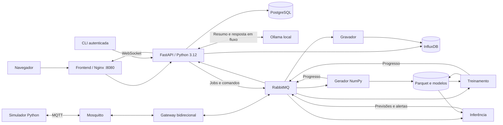

# Guia técnico do Smart Charge

> Consulte primeiro o [README](../README.md) para instalação e avaliação. Este guia aprofunda a implementação; a revisão consolidada está em [revisao-requisitos.md](revisao-requisitos.md). As instruções de execução partem da raiz do repositório.

## Ajustes da revisão de entrega

- Protótipo Flask isolado em `backend/legacy/`; dependências atuais exclusivamente em `backend/requirements.txt`.
- Histórico dos três sensores no Dashboard, consultado por `/api/telemetry/history?device_id=ponto01&minutes=30`. Consulta autenticada, período de 5 a 1.440 minutos e até 181 pontos agregados; não é uma segunda fonte de dados para o 3D.
- `automation_rules` registra a proteção térmica compartilhada de `services/rules.py`. `/api/rules` permite consulta autenticada; a política de segurança é fixa e executada localmente, não editável pela Web.
- Interface com detalhes expansíveis: sensores, controles de simulação, parâmetros avançados, explicações das métricas e mensagens técnicas. A função permanece disponível para avaliação.
- Desenvolvimento Vite encaminha REST/WebSocket ao Compose em `localhost:8080`; o Flask não é mais o destino do proxy.
- `infra/review-browser-test.mjs` valida a organização visual, o gráfico histórico, a disponibilidade dos parâmetros e a largura móvel. `tests.review_integration` valida regras e histórico nos três papéis.

Aplicação Web + IoT para monitoramento da disponibilidade de pontos de recarga de veículos elétricos.

## Segundo bimestre — infraestrutura Docker

Na branch `desenvolvimento-bimestre2`, com Docker Desktop/WSL2 iniciado, execute na raiz:

```powershell
docker compose up -d --build
```

Também é possível usar `docker compose up` em primeiro plano. A primeira execução baixa imagens, compila o frontend e baixa o modelo local do Ollama; requer internet e pode levar vários minutos. Nas próximas execuções, os dados e o modelo são reutilizados. Configure pelo menos 8 GB de memória para o Docker/WSL2, conforme o enunciado. Geração e treinamento compartilham o limite de um job por vez.

- Aplicação: http://localhost:8080
- FastAPI/Swagger: http://localhost:8080/docs
- Saúde da API: http://localhost:8080/api/health

O frontend é compilado com Node e servido por Nginx sem root; o backend usa Python 3.12 e FastAPI, também sem root. Apenas a porta do frontend é publicada, em `127.0.0.1`. Nginx encaminha API e WebSocket e resolve novamente os endereços internos quando containers são recriados. Os scripts Flask do primeiro bimestre continuam preservados, mas não executam no Compose.

**Estado atual:** infraestrutura, simulador dos três pontos, MQTT ↔ RabbitMQ, InfluxDB, JWT com três papéis, auditoria, sessões no PostgreSQL e WebSocket. O Laboratório gera de um a três milhões de leituras e treina dois regressores com métricas e baseline; a inferência publica saúde, RUL e alertas nos Insights e no Three.js. A Mensageria acompanha filas, taxas, consumidores e DLQ. O cadastro permite editar os três pontos e seus componentes. Operadores/administradores comandam atuadores e inspecionam a DLQ; administradores também editam cadastros, geram dados, treinam, selecionam versões e consultam auditoria. O Assistente local responde em fluxo usando Ollama e um resumo dos dados atuais, sem executar ações nos equipamentos.

Serviços: PostgreSQL 17, InfluxDB 2.7, Mosquitto 2, RabbitMQ 4.1 com gerenciamento, Ollama, FastAPI, frontend, gateway, writer, simulator, generator, trainer e inference. Todos os processos Python usam a mesma imagem Python 3.12. `bootstrap`, `mqtt-init`, `db-init` e `ollama-init` são tarefas de inicialização: terminar com código 0 é esperado. `db-init` cria uma conta PostgreSQL sem superusuário para a aplicação, o esquema e os três usuários de demonstração, preservando-os nas próximas subidas. `ollama-init` baixa e pré-carrega `qwen2.5:1.5b`; o frontend pode subir enquanto o download termina. Consulte a disponibilidade do modelo na aba Assistente local.

O bootstrap gera senhas aleatórias e a chave JWT em volumes Docker, fora do Git e sem exibi-las nos logs. Não há senha padrão. Os serviços recebem volumes separados com suas credenciais, somente leitura e acessíveis ao UID 10001. As senhas de demonstração ficam disponíveis somente à tarefa de inicialização, que grava hashes bcrypt no banco. Mosquitto bloqueia acesso anônimo e aplica ACLs por ponto; RabbitMQ possui usuários por serviço, permissões de tópicos, exchange `events`, filas separadas para gravação, inferência, WebSocket, comandos, geração e treino, além de `deadletters`. Todas as seis filas de trabalho têm consumidores. A conta `monitor` tem tag de monitoramento, leitura restrita à DLQ e nenhuma permissão de escrita/configuração; é usada somente pelo backend para consultar métricas e gerar a prévia preservada.

### Login e papéis

Depois de subir o Compose, exporte as credenciais geradas para um arquivo local ignorado pelo Git:

```powershell
powershell -ExecutionPolicy Bypass -File .\infra\export-demo-credentials.ps1
```

Abra `secrets/usuarios-demo.txt` e entre em http://localhost:8080. Não publique esse arquivo. Também é possível consultar no terminal com `docker compose run --rm --no-deps db-init python -m services.show_credentials`.

| Usuário / papel | Permissões |
| --- | --- |
| `visualizador` | Dashboard, histórico, dispositivos e sessões |
| `operador` | Visualização e comandos dos atuadores/simulador |
| `administrador` | Permissões do operador, edição do cadastro/faixas, auditoria, geração de dados e treinamento |

O JWT expira em uma hora e fica apenas na memória do navegador: atualizar a página exige novo login. Sair revoga a sessão no PostgreSQL e encerra seu WebSocket. Cinco falhas de login por conta ou vinte por IP em cinco minutos bloqueiam novas tentativas temporariamente. A auditoria registra logins, falhas, bloqueios, logout, solicitação/publicação/confirmação de comandos. Senhas, JWT e tickets não são gravados na auditoria.

O frontend faz uma carga inicial REST e passa a receber snapshots via WebSocket. Antes de conectar, solicita um ticket com JWT no cabeçalho HTTP. O ticket vale 30 segundos, só pode ser consumido uma vez e é enviado na primeira mensagem WebSocket; nenhum JWT ou ticket vai na URL. Reconexões pedem um novo ticket. A origem é verificada para conexões de navegadores.

Para verificar e parar:

```powershell
docker compose ps -a
docker compose logs --tail 100 api rabbitmq mosquitto
docker compose logs ollama-init
docker compose stop
docker compose start
```

`docker compose down` remove os containers e a rede, preservando os volumes. **Não use `docker compose down -v` para manutenção normal:** isso apaga os bancos, as credenciais e o modelo baixado. Não exclua somente o volume de credenciais, pois as senhas deixariam de corresponder às dos bancos existentes. Faça backup dos volumes antes de qualquer reinicialização destrutiva.

Configuração opcional: copie `.env.example` para `.env` e ajuste `FRONTEND_PORT`, `OLLAMA_MODEL`, `SIMULATION_INTERVAL` (0,2 a 60 segundos; use ponto decimal) ou `SIMULATION_SEED`. Não é necessário criar `.env` para subir. Alterar `OLLAMA_MODEL` exige recriar `ollama-init` para baixar e pré-carregar o novo modelo. A semente controla o ruído; os instantes e intervalos reais dependem da execução.

### Assistente local com Ollama

A aba **Assistente local** está disponível aos três papéis autenticados. Exemplos: “Resuma o estado das três estações”, “Explique os alertas ativos” e “Como os modelos se comparam ao baseline?”. A primeira resposta pode demorar enquanto o modelo é carregado em CPU; o texto aparece progressivamente e pode ser interrompido. A conversa permanece ao trocar de aba, mas é apagada da interface ao sair ou atualizar a página. **Nova conversa** limpa a interface; os registros de auditoria permanecem.

`GET /api/assistant/status` informa disponibilidade, download e carregamento. `POST /api/assistant/chat` recebe pergunta (até 1.200 caracteres) e UUID da conversa. A API prepara uma fotografia com leituras atuais, previsões, alertas ativos, métricas do modelo aprovado e arquitetura; inclui no máximo duas trocas anteriores da mesma conversa e usuário. Sem telemetria atual, os valores são enviados como ausentes. O modelo recebe somente esse resumo: não recebe credenciais, ferramentas, acesso SQL nem permissão para enviar comandos. Respostas podem conter erros; valores devem ser conferidos no Dashboard/Insights. RUL é uma previsão sintética com horizonte de 168 horas, não uma garantia de falha.

O backend chama o [chat do Ollama](https://docs.ollama.com/api/chat) no endereço interno fixo `http://ollama:11434` e retransmite eventos NDJSON (`status`, `context`, `token`, `done` ou `error`) com buffering desabilitado no Nginx. Markdown é exibido com HTML desabilitado, sem imagens nem links navegáveis. O modelo padrão é `qwen2.5:1.5b`, com dois threads de CPU, contexto de 4.096 tokens e saída de até 384 tokens. O Ollama usa no máximo um modelo carregado e uma geração paralela. Não há fallback para serviços de nuvem.

A API limita a uma resposta global por vez (`409` se ocupada), cinco perguntas aceitas por usuário/minuto (`429`), 150 segundos por resposta e 12.000 caracteres de saída. Cancelamento ou desconexão encerra a consulta e libera a vaga. Pergunta, usuário, modelo, resposta e situação final ficam em `assistant_requests`; início, conclusão, cancelamento, falha e rejeição também geram auditoria. Consultas interrompidas por reinício da API são marcadas como falha na próxima inicialização. Esses registros não são um histórico público de conversas.

Validação da integração real (com o modelo baixado e serviços ativos):

```powershell
docker compose exec -T api python -m unittest discover -s tests -v
docker compose run --rm --no-deps db-init python -m tests.assistant_integration
cd frontend
node --experimental-strip-types --test tests/assistant.test.ts tests/twin.test.ts
```

O teste de integração faz perguntas reais em CPU, verifica os três papéis, streaming, auditoria, bloqueio de concorrência, limite de frequência, cancelamento e ausência de comandos de atuação. Pode levar alguns minutos. O teste de navegador `infra/assistant-browser-test.mjs` usa uma instância dedicada do Chrome com depuração em `9223`; verifica a tela, troca de abas, cancelamento e isolamento entre sessões, sem exibir credenciais.

### Telemetria e comandos internos

O simulador usa três contas MQTT independentes. Os pontos 01 e 02 iniciam ocupados; o 03, disponível. Cada ponto mede temperatura (°C), corrente (A) e tensão trifásica de linha (V). A potência de entrada é `√3 × tensão × corrente / 1000`; a energia fornecida à bateria considera a eficiência do módulo. O desgaste injetado eleva temperatura e corrente e reduz tensão/eficiência. Rótulos de saúde, RUL e severidade real da falha não são publicados na telemetria.

O limitador aplica o menor valor entre o limite solicitado e a proteção térmica. A proteção reduz a potência a 30% quando a temperatura interna chega a 65 °C, liberando somente abaixo de 55 °C. Abrir o contator ou liberar a vaga zera potência e corrente e interrompe o avanço da bateria. O contato continua representado separadamente da ocupação: veículo estacionado não significa recarga ativa.

As leituras usam JSON com `id`, `timestamp` UTC, `type`, `device_id` e `payload`. MQTT usa QoS 1; o gateway só confirma a telemetria ao Mosquitto após confirmação de publicação no RabbitMQ. O writer confirma a fila após escrita síncrona no InfluxDB; reentregas usam o mesmo equipamento/instante e sobrescrevem o ponto, evitando duplicação. Falhas de escrita tentam uma reentrega antes da DLQ. Comandos inválidos também vão à DLQ; comandos aguardando na fila expiram em 30 segundos. A confirmação efetiva do atuador é `last_command_id` na próxima telemetria, não apenas a publicação no broker.

Os botões Web usam `POST /api/devices/{id}/commands`, restrito a operador/administrador. A solicitação e a auditoria entram na mesma transação PostgreSQL; um publicador envia o comando ao RabbitMQ e registra a confirmação do broker. A interface só mostra o comando como aplicado após observá-lo na telemetria. Há um comando pendente por ponto, com prazo de 30 segundos. Gateway e simulador rejeitam comandos vencidos.

Para diagnóstico local, a CLI usa a mesma API autenticada e pede a senha do operador sem exibi-la:

```powershell
docker compose exec api python -m services.command ponto01 set_contactor off
docker compose exec api python -m services.command ponto01 set_contactor on
docker compose exec api python -m services.command ponto02 set_power_limit 50
docker compose exec api python -m services.command ponto03 set_occupied on
docker compose exec api python -m services.command ponto01 set_fault 100
docker compose exec api python -m services.command ponto01 set_fault 0
```

`set_fault` injeta um cenário sintético para demonstrar a degradação; a IA preditiva será conectada posteriormente. A temperatura reage gradualmente, portanto a proteção térmica leva dezenas de segundos para atuar após uma falha forte. A estimativa de conclusão usa a potência atual e é recalculada continuamente; ainda não modela antecipadamente a redução de potência próxima de 100% de bateria.

Ao parar o simulador, o dashboard mostra “SEM DADOS” após cerca de 10 segundos com o intervalo padrão. O histórico REST consulta o InfluxDB; o WebSocket parte desse histórico e acrescenta mudanças ao vivo. O simulador salva bateria, energia, atuadores e identidade da sessão no volume `simulator-state`. Reiniciá-lo preserva esses valores; o tempo parado não é contado como recarga.

O consumidor da API persiste o resumo das sessões no PostgreSQL, incluindo início, bateria inicial/atual, capacidade, potência, energia, previsão de conclusão e estado (carregando, pausada, concluída ou encerrada). Abrir o contator pausa a mesma sessão; liberar a vaga a encerra. A próxima entrada cria outra identidade de sessão e zera a energia fornecida. Os três pontos de demonstração são cadastrados automaticamente; a edição do cadastro será implementada depois. As leituras completas continuam no InfluxDB.

### Laboratório de Dados e treinamento

Entre como administrador e abra **Laboratório e treinamento**. Configure o volume, número de equipamentos, sensores de cada tipo, período, falhas, modos, ruído, faltantes, outliers e semente. Clique em **Gerar dados**, aguarde a conclusão, selecione o conjunto pronto e clique em **Treinar os dois modelos**. Visualizadores e operadores acompanham resultados, mas não disparam jobs.

Cada linha é uma leitura completa de um equipamento, com temperatura, corrente e tensão agregadas e as leituras individuais dos sensores configurados. O mínimo de 1.000.000 de linhas corresponde a pelo menos 3.000.000 de medições individuais. O teto é 3.000.000 de linhas, 300 equipamentos e quatro sensores de cada tipo por equipamento. O gerador NumPy trabalha em blocos de 5.000 linhas e grava partições Parquet por equipamento no volume `lab-artifacts`, separado do InfluxDB ao vivo. O manifesto registra parâmetros, contagens, faltantes, outliers e versão do gerador. A mesma configuração e semente reproduzem os arquivos.

As trajetórias têm ciclos diários, variação de carga, diferenças entre máquinas e degradação progressiva. Modos disponíveis: perda de refrigeração, desgaste de capacitores e aumento de resistência. `health`, `time_to_failure_hours`, `rul_hours` e `degrading` são rótulos de laboratório; não entram nas features nem na telemetria IoT. `time_to_failure_hours` preserva o tempo verdadeiro até a falha. O alvo de regressão `rul_hours` é sua versão limitada a 168 horas: o valor no teto representa o horizonte máximo do modelo, e não uma confirmação de falha exatamente dali a sete dias.

Os jobs são registrados com auditoria no PostgreSQL e publicados por uma saída transacional no RabbitMQ (`jobs.generate` / `jobs.train`). Cada worker usa sua própria conta AMQP e consome sua fila. O progresso é persistido e publicado em `jobs.progress.<id>`, consumido pela API; a interface acompanha pelo WebSocket. A API não espera a geração ou o treino terminar. Mensagens são confirmadas depois da conclusão; interromper um worker deixa o job disponível para retomada. Após três tentativas interrompidas, ele falha. Erros de processamento registram falha e preservam a mensagem original na DLQ.

O banco impõe um job de laboratório ativo por vez. Os workers têm dois núcleos de CPU cada e limites de memória de 1.500 MB (geração) e 2.500 MB (treinamento). Enquanto não há jobs, os processos ficam aguardando suas filas. Os arquivos persistem entre reinicializações do Compose; novas gerações criam conjuntos separados e consomem espaço adicional em disco.

O módulo compartilhado `backend/services/ml/features.py` calcula 20 atributos, usando janelas de até 16 leituras presentes/passadas: últimas leituras, médias, desvios, máximos, tendências por hora, potência e contexto diário. Valores inválidos são tratados de forma consistente e a imputação por mediana é ajustada somente no treino. A divisão é por equipamento: 70% treino, 15% validação e 15% teste, sem sobreposição. Todos os equipamentos entram nessa divisão; o ajuste usa uma amostra reprodutível por equipamento, com limite configurável de 10.000 a 300.000 exemplos de treino, padrão 200.000, e até 30.000 exemplos em cada grupo de avaliação.

São treinados dois `HistGradientBoostingRegressor`, para saúde e RUL. Duas taxas de aprendizado são comparadas usando a validação; o teste mede apenas a configuração selecionada. O baseline é `DummyRegressor` que prevê a média do treino. A tela mostra MAE, RMSE, R², previsto contra real e importância por permutação em uma amostra do teste. A versão só é aprovada quando **ambos** os modelos vencem o baseline em **MAE e RMSE no teste**. Uma versão reprovada não substitui a anterior.

Modelos, contrato de atributos e métricas ficam versionados em `lab-artifacts`; o PostgreSQL registra a versão aprovada. A inferência acompanha essa seleção sem reiniciar. Os resultados atuais medem generalização entre equipamentos sintéticos, sem validação em equipamentos físicos.

Validação executada com a configuração padrão: 1.000.000 de linhas físicas em 120 partições Parquet, 3.000.000 de medições; os dois modelos venceram o baseline:

| Alvo | MAE do modelo | MAE do baseline | RMSE do modelo | R² |
| --- | ---: | ---: | ---: | ---: |
| Saúde (pontos) | 2,432 | 8,229 | 7,277 | 0,765 |
| RUL (horas) | 5,692 | 16,767 | 15,556 | 0,708 |

### Insights e inferência ao vivo

Abra **Insights de IA** após o login. Cada ponto mostra saúde, RUL em horas, tendência recente, amostras na janela e versão efetivamente carregada. A tela também mostra os alertas ativos e encerrados. Os valores são estimativas dos modelos sintéticos; a RUL tem horizonte máximo de 168 horas.

O serviço `inference` consome `inference.telemetry` pela sua conta RabbitMQ, com limite de um núcleo e 1 GB de memória. A janela mantém até 16 leituras passadas e começa a prever após quatro leituras válidas. A extração usa exatamente `services/ml/features.py`, compartilhado com o treinamento; somente temperatura, corrente, tensão, potência e os instantes entram no cálculo. Saúde verdadeira, RUL verdadeira, severidade injetada e informações de sessão não entram nas features.

A inferência publica `predictions.station.power.<id>` e transições em `alerts.station.power.<id>`. A API consome ambos em `api.events`, persiste os alertas no PostgreSQL e os entrega junto às previsões pelo WebSocket. Eventos de alerta têm identificadores determinísticos e deduplicação transacional. Aberturas, alterações e encerramentos também entram na auditoria. A interface mostra a versão realmente em uso, que pode diferir temporariamente da versão selecionada enquanto o modelo é carregado.

Histerese dos alertas:

- Atenção: três previsões consecutivas com saúde abaixo de 70 **ou** RUL abaixo de 72 h.
- Crítico: três previsões consecutivas com saúde abaixo de 40 **ou** RUL abaixo de 24 h.
- Encerramento: dez previsões consecutivas com saúde pelo menos 75 **e** RUL pelo menos 84 h.
- Sem carga de pelo menos 1 kW, os contadores são suspensos/reiniciados e alertas existentes são preservados. Os cards indicam que a estimativa está limitada por falta de carga.

Previsões antigas não são apresentadas como atuais. Sem telemetria ou inferência recente, os cards escondem saúde/RUL e mostram o motivo após aproximadamente dez segundos no intervalo padrão. Os alertas históricos persistem. Leituras da fila com mais de 30 segundos (ou três intervalos configurados, se maior) são confirmadas e ignoradas pelo consumidor ao vivo; o histórico completo continua no InfluxDB. Isso permite drenar uma fila acumulada sem emitir diagnósticos antigos como novos.

O processo consulta a versão aprovada a cada três segundos, carrega apenas arquivos locais gerados pelo próprio treinamento e valida o contrato de atributos antes de trocar os dois regressores. Um arquivo ausente ou incompatível mantém o último modelo válido e informa o problema na interface. Em uma instalação sem modelo aprovado, a tela pede treinamento, sem inventar saúde ou RUL. O volume de modelos é montado somente para leitura na inferência.

Para demonstrar a troca sem reiniciar, entre como administrador, selecione outra versão aprovada no Laboratório e clique em **Usar esta versão na inferência**. Confira a mudança do identificador nos Insights. Novos treinos aprovados também entram em uso automaticamente. Versões que não venceram o baseline não podem ser ativadas.

Para demonstrar uma falha, use **Simular veículo** em uma vaga livre, feche o contator, deixe o limite em 100% e clique em **Injetar falha**. A temperatura muda gradualmente; acompanhe a queda de saúde/RUL e o alerta. Clique em **Remover falha** e aguarde o resfriamento e as dez previsões de recuperação. Se o contator estiver aberto ou a bateria cheia, não haverá carga suficiente para essa demonstração.

Validação executada: a saúde do ponto 03 caiu de 97,7 para 56,3 durante a falha; o alerta foi persistido e recebido pelo WebSocket. Ao recuperar, a histerese encerrou o alerta. Duas versões aprovadas foram alternadas e restauradas no mesmo processo de inferência, sem reiniciar o container.

### Gêmeo digital Three.js

Abra **Gêmeo digital 3D** após o login. A cena procedural mostra as três estações e 18 componentes: três sensores, dois atuadores e um módulo de potência por estação. Os IDs dos componentes são cadastrados em `device_components` no PostgreSQL e consultados em `GET /api/devices/components`: `ponto01.temperature`, `.current`, `.voltage`, `.contactor`, `.limiter`, `.module`, e equivalentes para os pontos 02/03. As posições existem somente em `frontend/src/twin.ts`, indexadas pelos mesmos IDs.

Arraste para orbitar, use a roda para aproximar e clique num item para abrir seu painel. Os botões **Itens monitorados** oferecem a mesma seleção por teclado. O painel mostra a última leitura, um minigráfico com até 60 amostras, saúde, RUL e, para atuadores, os comandos permitidos ao papel. O visualizador não tem botões de comando. O operador e o administrador enviam comandos pela mesma API autenticada e auditada do dashboard; a cena só muda quando a confirmação aparece na telemetria seguinte.

A cena consome exclusivamente o estado recebido pelo WebSocket, sem ligação direta com o simulador. A consulta REST carrega somente o catálogo de componentes. Mesmo que haja dados no snapshot REST do dashboard, o 3D espera um frame WebSocket antes de animar. A geometria é criada uma vez; o loop de animação consulta o estado sem reconstruir a cena a cada mensagem. Árvores repetidas usam `InstancedMesh`; os recursos WebGL são liberados ao sair da aba. O módulo Three.js é carregado sob demanda.

Reações aos dados:

- A ocupação faz o veículo aparecer/desaparecer; a barra sobre ele acompanha a bateria.
- Partículas percorrem o cabo na direção da recarga, com velocidade proporcional à potência. O cabo termina exatamente no conector da estação e na porta do veículo; sem veículo, usa o encaixe de estacionamento.
- O efeito térmico acompanha a temperatura; o ventilador interno e os indicadores de energia animam apenas sob potência medida.
- O contator mostra a posição aberta/fechada e o limitador indica o percentual efetivo de potência.
- A oscilação visual do módulo aumenta com a degradação prevista. Ela representa saúde estimada, não um sensor adicional de vibração.

Os sensores usam as faixas cadastradas para verde/atenção/crítico. O módulo usa o nível dos alertas da IA; ausência de previsão ou telemetria deixa o item cinza. A proteção térmica colore o limitador em atenção. Sem dados do simulador, a cena congela e mostra o aviso após o timeout padrão de aproximadamente dez segundos. Se o WebSocket cair ou parar de entregar frames, o 3D interrompe a animação imediatamente na desconexão ou em até 3,5 segundos sem frames. A câmera continua disponível para inspeção manual.

É necessário WebGL2. Se o navegador não conseguir iniciar o contexto gráfico, há uma mensagem explícita e a lista acessível de componentes continua disponível, sem inventar uma cena animada. Não há modelos, texturas ou imagens remotas.

Se a área 3D ficar vazia, use **Recentrar câmera** ou **Reiniciar 3D**. **Modo compatível** recria o contexto com resolução limitada e sem sombras/antialiasing, reduzindo exigências do driver. O primeiro desenho tem dimensões inicializadas de forma síncrona, e falhas de compilação gráfica ou do loop são apresentadas na tela. Os testes de navegador verificam pixels efetivamente desenhados, além da existência do canvas, incluindo escala fracionada e os três controles de recuperação.

Validação no Chrome isolado: renderização WebGL2, 18 itens, seleção real por raycast, minigráfico, visualizador sem comandos, comando do contator por operador e restauração do estado. Com o simulador parado, os pixels do canvas permaneceram idênticos entre frames separados por mais de um segundo; ao religar, a telemetria retomou a cena.

Testes da lógica do 3D, usando Node.js 24:

```powershell
cd frontend
node --experimental-strip-types --test tests/twin.test.ts
```

O teste de navegador em `infra/twin-browser-test.mjs` usa Chrome isolado com depuração local na porta 9223, as credenciais do arquivo ignorado `secrets/usuarios-demo.txt` e a aplicação Docker na porta 8080. Ele pausa e religa o simulador e abre/fecha o contator do ponto 03, restaurando seu estado. As capturas ficam em `secrets/` e não entram no Git.

### Mensageria RabbitMQ

Abra **Mensageria** para acompanhar as sete filas (seis de trabalho e a DLQ), mensagens prontas, mensagens sem confirmação, consumidores, taxas de publicação/entrega e as últimas mensagens. Uma thread do backend consulta a API de gerenciamento a cada dois segundos, com timeout; o WebSocket entrega o snapshot. A janela de estatísticas do próprio RabbitMQ pode acrescentar alguns segundos de atraso. A interface marca a consulta indisponível/desatualizada quando o broker ou o transporte deixam de responder, preservando o horário da última amostra.

O navegador não acessa o RabbitMQ diretamente e não recebe a senha de monitoramento. Os endpoints consultam somente o vhost `smartcharge` e o exchange `events`, sem aceitar URLs de broker fornecidas pelo cliente. O resumo de consumidores mostra a conta de cada serviço, a confirmação explícita e o prefetch. A taxa de publicações no exchange é diferente da soma de entradas nas filas, pois o barramento distribui cópias para consumidores diferentes.

As mensagens recentes são uma amostra em memória dos últimos 40 eventos recebidos ou publicados pela API, incluindo telemetria, previsões, alertas, comandos e jobs. Não constituem um histórico de todo o RabbitMQ. Campos com senhas, tokens e segredos são ocultados na visualização; limites de tamanho/profundidade protegem a tela. Os originais no broker permanecem intactos.

Operador e administrador podem clicar em **Inspecionar sem remover** para visualizar até cinco mensagens da DLQ. A API faz a leitura com `ack_requeue_true`, devolvendo as mensagens à fila; isso pode mudar sua ordem e a marca de reentrega. Conteúdo inválido ou grande demais para a prévia é identificado sem alterar o original. Cada inspeção fica na auditoria. Não há rota para apagar, purgar ou republicar a DLQ nesta etapa.

Para validar, deixe a Mensageria aberta, rode `docker compose stop writer` no terminal e observe `writer.telemetry` ficar sem consumidor e crescer. Depois rode `docker compose start writer`: o consumidor volta e a fila esvazia. A API não recebe acesso ao socket do Docker; esses comandos de administração são executados localmente pelo responsável pela demonstração.

### Cadastro e gerenciamento dos dispositivos

Abra **Dispositivos**. Os três pontos e seus 18 componentes são cadastrados automaticamente na inicialização; a página permite consultar e gerenciar esses registros. A quantidade de pontos e os IDs permanecem fixos nesta versão, conforme o escopo dos três simuladores e das permissões MQTT. Não há adição/remoção de pontos físicos ou alteração de IDs pela interface.

O administrador edita nome, localização e descrição dos pontos, permissão para novos comandos e nomes/faixas dos componentes. Visualizador e operador consultam o cadastro. O servidor valida as faixas: crítico mínimo ≤ normal mínimo < normal máximo ≤ crítico máximo, com valores finitos; atuadores e equipamentos não recebem faixas numéricas de sensores. Toda alteração registra antes/depois e o usuário na auditoria.

O cadastro usa revisão para evitar sobrescrita de edições concorrentes: uma gravação baseada em revisão antiga retorna conflito e pede recarga. Os formulários mantêm o rascunho durante os frames WebSocket; **Recarregar cadastro** consulta a versão atual. As mudanças salvas atualizam o dashboard e o catálogo do 3D em até alguns segundos, sem novo login. Mudar a faixa de um sensor muda suas cores no 3D; isso não altera os limites de alertas da IA nem a proteção térmica do simulador.

**Permitir novos comandos da aplicação** controla a autorização do ponto. O bloqueio é validado na API, inclusive para chamadas fora do navegador, e desabilita os controles no dashboard/3D. Para parar fisicamente a recarga simulada, use o contator; comandos já publicados e o monitoramento continuam funcionando. As tabelas e os dados históricos são preservados.

Validação executada: permissões dos três papéis, faixas inválidas, revisão antiga, bloqueio de comandos, DLQ preservada, alteração do nome no dashboard e alteração da cor de sensor no 3D por WebSocket. No Chrome, a fila cresceu com o gravador parado e drenou ao voltar. Os dados originais foram restaurados após os testes.

### Verificação

```powershell
docker compose exec api python -m unittest discover -s tests -v
docker compose run --rm --no-deps db-init python -m tests.security_integration
docker compose run --rm --no-deps db-init python -m tests.integration
docker compose run --rm --no-deps db-init python -m tests.lab_integration
docker compose run --rm --no-deps db-init python -m tests.inference_integration
docker compose run --rm --no-deps db-init python -m tests.management_integration
```

Os testes unitários verificam física da recarga, causalidade das features, divisão por equipamento e reprodutibilidade/qualidade da geração. O teste de segurança verifica os três papéis, assinatura/revogação do JWT, limite de login, auditoria, uso único/expiração do ticket e WebSocket pelo Nginx. O teste integrado altera temporariamente atuadores simulados, confere as respostas pela API e restaura os estados anteriores. Também cria e encerra uma sessão no ponto 03 quando ele está livre. O teste de laboratório **cria um novo conjunto de um milhão de linhas e treina os modelos**, validando o volume em disco, as permissões e a comparação com baseline; execute-o com o laboratório sem outros jobs ativos.

Para testar o barramento, pare o gravador e observe a fila crescer; depois inicie-o e observe a drenagem:

```powershell
docker compose stop writer
docker compose exec rabbitmq rabbitmqctl list_queues -p smartcharge name messages consumers
docker compose start writer
docker compose exec rabbitmq rabbitmqctl list_queues -p smartcharge name messages consumers
```


